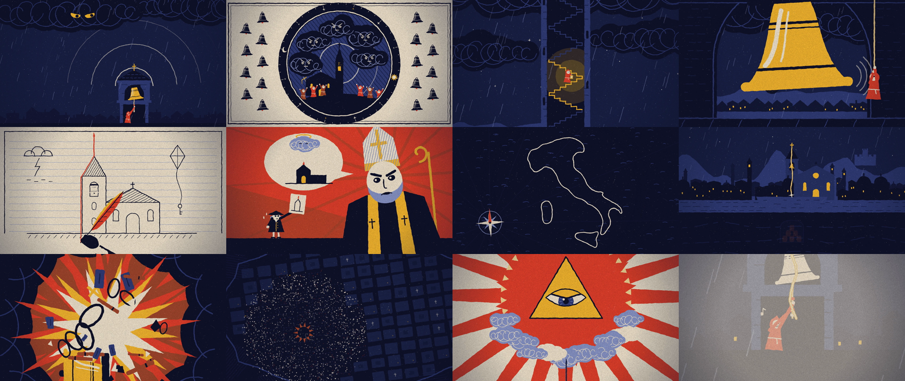

# voiceover-to-animation

A Claude Code skill that turns a voiceover file into a finished 2D animated short where **every frame is drawn by code**. No video models, no stock footage, no editor: Claude transcribes the narration to word timings, storyboards against them, writes Canvas-2D scenes as pure functions of time, reviews its own work through contact sheets, and renders an MP4 with headless Chromium and ffmpeg.



*One frame every six seconds from the bundled example, a 71-second film made from a single voiceover file.*

## Install

Clone into your skills folder:

```bash
git clone https://github.com/igm61799-cloud/voiceover-to-animation ~/.claude/skills/voiceover-to-animation
```

Requirements on the machine that runs it:

```bash
pip install faster-whisper playwright pillow
python -m playwright install chromium
```

plus `ffmpeg` on your PATH. A GPU is optional (transcription falls back to CPU).

## Use

Put a `voiceover.mp3` in an empty folder, open Claude Code there and say something like:

> Here's a voiceover. Turn it into a fully coded 2D animated short. Pick the art direction yourself.

You get `output.mp4` (1920x1080, 30 fps), a contact sheet, and a `src/` folder you can open in a browser as a live player or keep editing.

## What is inside

| path | what it is |
|---|---|
| `SKILL.md` | the workflow Claude follows |
| `scripts/transcribe.py` | word-level timestamps (faster-whisper) |
| `assets/template/` | project skeleton: `engine.js` (easing, seeded randomness, camera, print-style motifs), `main.js` (timeline, paper-grain post-process, live player), `scenes.js` (your film), `render.py` (stills, contact sheets, parallel render + audio mux) |
| `references/storyboarding.md` | how narration becomes shots and beats |
| `references/engine-api.md` | every engine helper in one page |
| `references/pitfalls.md` | mistakes that are easy to make and hard to see |
| `references/example-bells/` | the complete example film: storyboard plus ~900 lines of scene code |

## How it works

Every scene is a function `(g, t, u)` that draws one frame for time `t` and remembers nothing. Because any frame can be drawn on its own:

- Claude can render stills at exact timestamps and look at them, which is how it reviews its work;
- the final render is split across parallel browser instances;
- sync with the audio is exact, since the visuals are computed from the same clock.

The default look is a five-ink linocut print with hand-cut "boiling" edges and paper grain. Change the palette and the `POST` switches in `scenes.js` for a different style.

## Render commands (inside a project)

```bash
python render.py stills 1.0,2.5,7 name     # contact sheet of exact timestamps -> work/name.png
python render.py sheet 4                   # whole film, one frame every 4 s -> work/overview.png
python render.py full --workers 8          # output.mp4 with the voiceover
```
